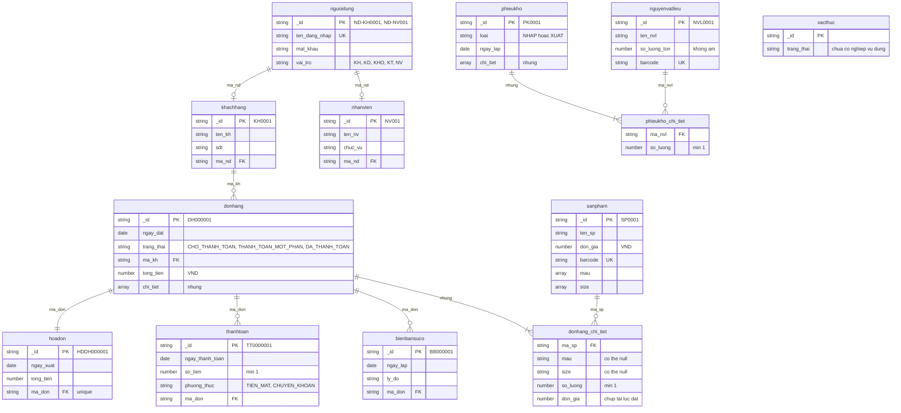

# Sơ đồ cơ sở dữ liệu MongoDB — Hệ thống quản lý công ty may mặc (bán sỉ)

Nguồn: [app/schema.py](../app/schema.py). CSDL `maymac`, 11 collection. Dán khối Mermaid vào bất kỳ trình xem Markdown hỗ trợ Mermaid (GitHub, VS Code + extension, mermaid.live) để xem sơ đồ.

## 1. Sơ đồ quan hệ (ER)

- `PK` là `_id` (mã nghiệp vụ dạng chuỗi), `FK` là tham chiếu bằng mã tới collection khác.
- Hai thực thể có hậu tố `_chi_tiet` **không phải collection riêng**: chúng là mảng được **nhúng** trong document cha.



## 2. Ví dụ document thực tế

`donhang` (chi tiết nhúng, đơn giá chụp lại tại thời điểm đặt):

```json
{
  "_id": "DH000001",
  "ngay_dat": "2026-05-12T08:30:00Z",
  "trang_thai": "THANH_TOAN_MOT_PHAN",
  "ma_kh": "KH0042",
  "tong_tien": 21500000,
  "chi_tiet": [
    { "ma_sp": "SP0018", "mau": "Đen", "size": "L",  "so_luong": 100, "don_gia": 145000 },
    { "ma_sp": "SP0032", "mau": "Be",  "size": "XL", "so_luong": 50,  "don_gia": 140000 }
  ]
}
```

`phieukho` (xuất kho nguyên vật liệu):

```json
{
  "_id": "PK0001",
  "loai": "XUAT",
  "ngay_lap": "2026-05-13T02:00:00Z",
  "chi_tiet": [
    { "ma_nvl": "NVL0001", "so_luong": 200 },
    { "ma_nvl": "NVL0007", "so_luong": 50 }
  ]
}
```

## 3. Nhúng hay tham chiếu

| Quan hệ | Cách lưu | Lý do |
|---|---|---|
| Đơn hàng – dòng chi tiết | **Nhúng** | Luôn đọc cùng đơn; số dòng nhỏ (1–4 dòng mỗi đơn mẫu); ghi đơn là một thao tác nguyên tử |
| Phiếu kho – dòng chi tiết | **Nhúng** | Giống đơn hàng |
| Đơn hàng – hóa đơn | Tham chiếu (`ma_don` unique) | Hóa đơn là chứng từ độc lập, có vòng đời riêng |
| Đơn hàng – thanh toán | Tham chiếu | Một đơn có nhiều lượt thanh toán, số lượng không giới hạn trước |
| Đơn hàng – biên bản sự cố | Tham chiếu | Chỉ phát sinh ở một số ít đơn |
| Đơn hàng – khách hàng, sản phẩm | Tham chiếu | Dữ liệu dùng chung, thay đổi độc lập |
| Người dùng – khách hàng/nhân viên | Tham chiếu | Tách tài khoản khỏi hồ sơ |

## 4. Chỉ mục

| Collection | Index |
|---|---|
| `nguoidung` | `ten_dang_nhap` (unique) |
| `khachhang` | `ma_nd` (sparse) |
| `sanpham` | `barcode` (unique, sparse) |
| `nguyenvatlieu` | `barcode` (unique, sparse), `so_luong_ton` |
| `donhang` | `(ma_kh, ngay_dat desc)`, `ngay_dat desc` |
| `hoadon` | `ma_don` (unique) |
| `thanhtoan` | `ma_don` |
| `phieukho` | `(loai, ngay_lap desc)` |
| `bienbansuco` | `ma_don` |
